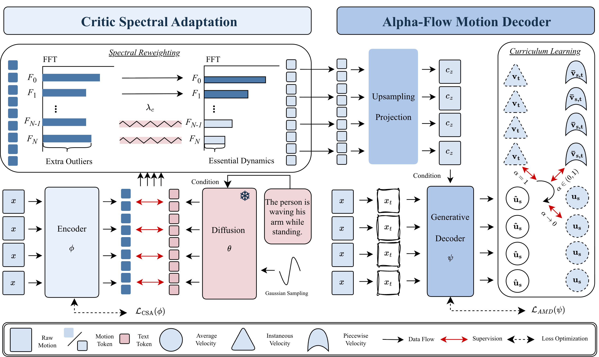

<div align="center">

# DiMoT
### Improving the Diffusability of Motion Tokenizer

**NeurIPS 2026 · Spotlight**

Guanhe Huang\* · Songqiao Han\* · Tangzheng Lian · Oya Celiktutan  
King's College London · \*Equal contribution

[**Paper**](https://arxiv.org/abs/2611.10160) · [**Project Page**](https://githubhgh.github.io/dimot/)

</div>

> **Preview release.** This repository currently provides the paper overview, method figure, qualitative examples, and citation. Training/inference code and pretrained weights are not yet available.

## Overview

DiMoT improves text-to-motion generation by refining the motion tokenizer. It combines:

- **Critic Spectral Adaptation (CSA):** a frozen, text-conditioned diffusion model guides encoder adaptation, with spectral weighting to suppress high-frequency latent shortcuts.
- **Alpha-Flow Motion Decoder (AMD):** a latent-conditioned generative decoder learns average-velocity prediction with a curriculum, enabling one-step motion decoding.



## Qualitative examples

<table>
  <tr>
    <td width="50%" align="center"></td>
    <td width="50%" align="center"></td>
  </tr>
  <tr>
    <td align="center">They are dancing latin, stomping their feet and swaying their hips.</td>
    <td align="center">One person sneaks up behind the other person and playfully nudges them.</td>
  </tr>
</table>

[More examples on the project page →](https://githubhgh.github.io/dimot/#gallery)

## Results reported in the paper

| Dataset | Method | FID ↓ | R-Precision Top-3 ↑ |
| --- | --- | ---: | ---: |
| InterHuman | MLD++ | 5.046 | 0.688 |
| InterHuman | **DiMoT** | **4.716** | **0.739** |
| Inter-X | MLD++ | 0.446 | 0.732 |
| Inter-X | **DiMoT** | **0.335** | **0.746** |

Values are from Table 1 of the paper; see the paper for confidence intervals and the full comparison. Tokenizers are trained separately on each dataset, and these results do not establish cross-dataset transfer.

## Release status

- [x] Paper and project page
- [x] Method overview and qualitative examples
- [ ] Training and inference code
- [ ] Evaluation scripts and environment instructions
- [ ] Pretrained checkpoints

## Citation

```bibtex
@article{huang2026dimot,
  title={Improving the Diffusability of Motion Tokenizer},
  author={Huang, Guanhe and Han, Songqiao and Lian, Tangzheng and Celiktutan, Oya},
  journal={arXiv preprint arXiv:2611.10160},
  year={2026},
  url={https://arxiv.org/abs/2611.10160}
}
```

## Contact

For questions about the paper or release, please open an issue or contact [Guanhe Huang](mailto:guanhe.huang@kcl.ac.uk).

The paper is available under CC BY 4.0 on arXiv. Licensing for code and model weights will be specified with their release.
